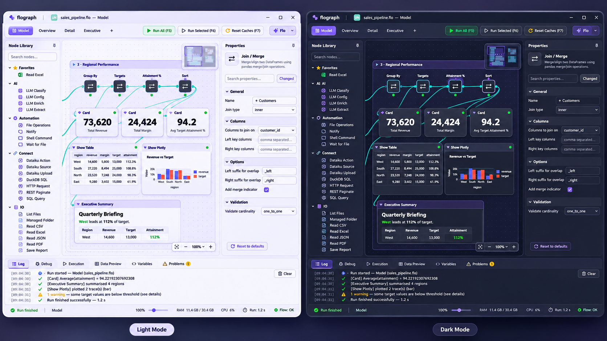
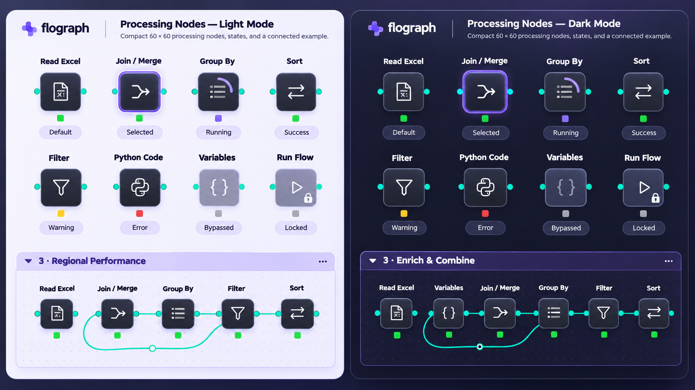
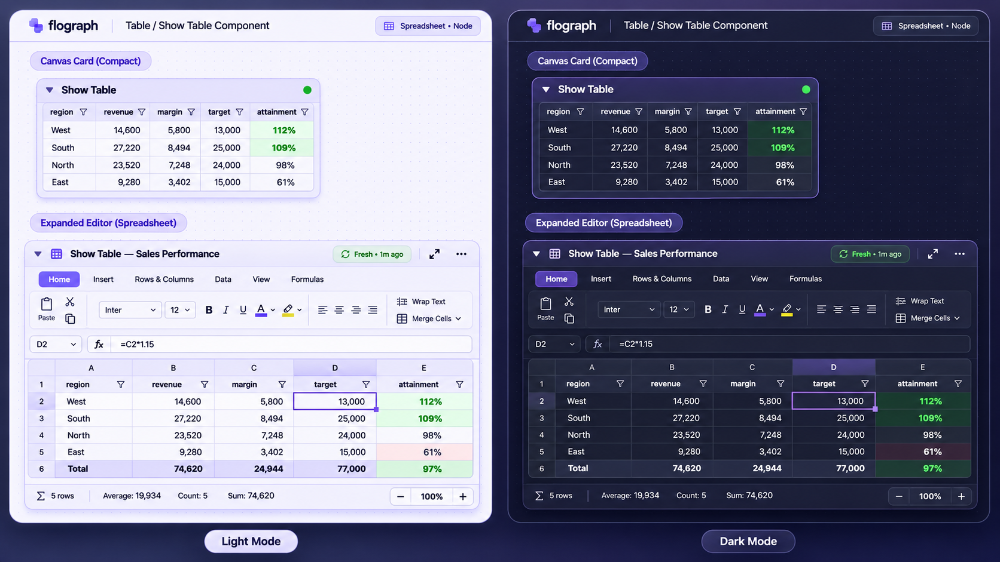
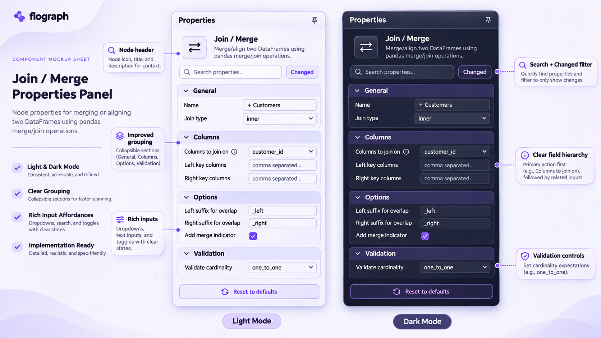
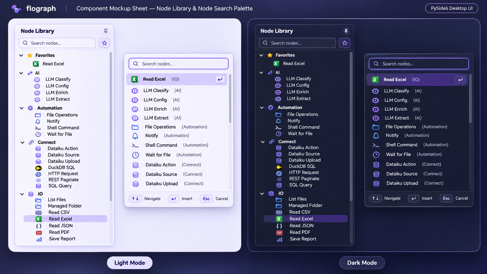
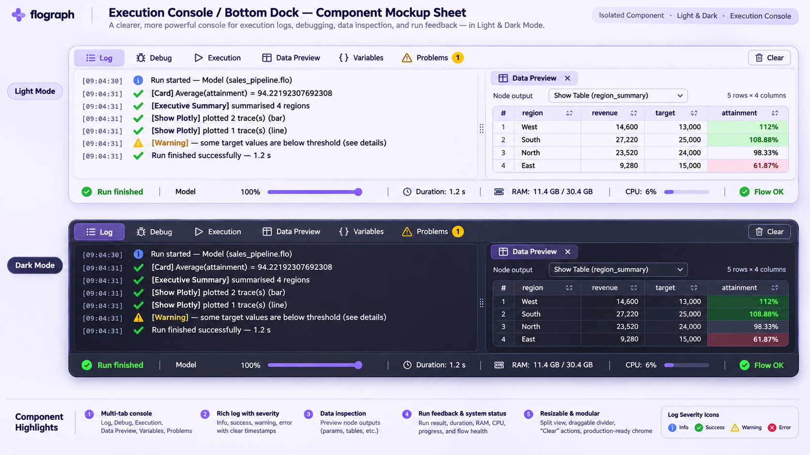

# flograph UI/UX redesign — reference assets

These visual references support [issue #109](https://github.com/redthista/flograph/issues/109) and the [Claude implementation specification](flograph_ui_ux_redesign_goal_for_claude.md).

## Mockup gallery

All six high-fidelity light/dark PNGs are committed in [`mockups/`](mockups/).

### Full canvas — light & dark

[View full-resolution image](mockups/flograph_light_and_dark_mode_comparison.png)

### Processing nodes and states

[View full-resolution image](mockups/flograph_processing_nodes_light_and_dark_modes.png)

### Spreadsheet and Show Table cards

[View full-resolution image](mockups/flograph_show_table_modes.png)

### Join / Merge Properties panel

[View full-resolution image](mockups/flograph_join_merge_panel_showcase.png)

### Node Library and search palette

[View full-resolution image](mockups/flograph_node_library_light_and_dark_modes.png)

### Execution console and data preview

[View full-resolution image](mockups/flograph_execution_console_mockup_sheet.png)

## Design constraints

- Preserve flograph's **60×60 compact processing nodes** and larger, resizable live data and visualization cards.
- Preserve node library, keyboard shortcuts, property editing/search, typed ports, variable bindings, caching, execution, project formats, custom styles, dashboard/report rendering, and node packs.
- Treat the PNGs as visual targets, **not** a replacement for documented behaviour.
- Implement incrementally using the [full Claude implementation specification](flograph_ui_ux_redesign_goal_for_claude.md).
